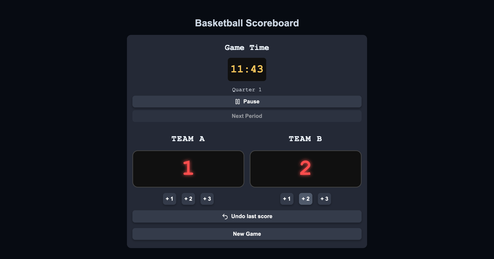
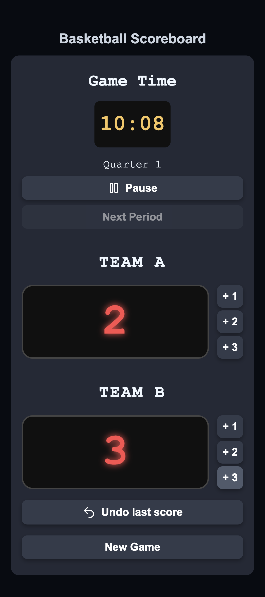
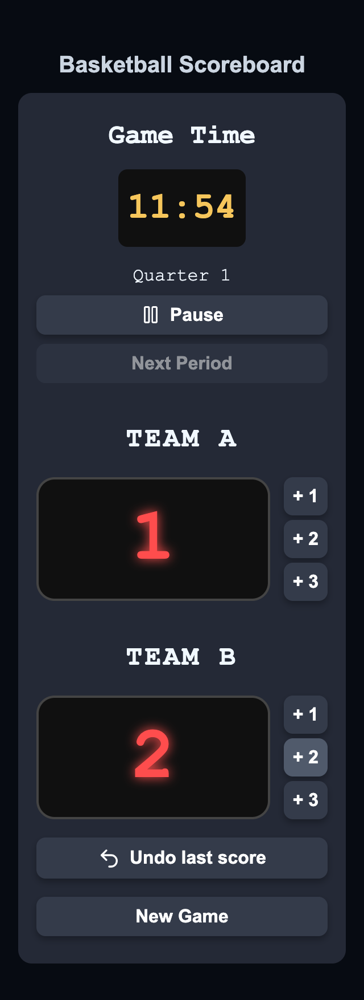

# Basketball Scoreboard 🏀

An interactive basketball scoreboard built using HTML, CSS and vanilla JavaScript.

The application allows users to track scores for two teams, manage the game clock, progress through quarters and overtime periods, undo the most recent scoring action and reset the game.

This project was developed as part of my frontend web development journey, with a focus on JavaScript fundamentals, DOM manipulation, state management, responsive design and accessibility.

## Live Demo

[View the Basketball Scoreboard](https://mepopis.github.io/basketball-scoreboard/)

## Screenshots

### Desktop View

    

### Mobile View

    
    &nbsp;&nbsp;
    

## Features

- Interactive scoring with +1, +2 and +3 point controls for each team.
- 48-minute game clock divided into four 12-minute quarters.
- Start, pause and resume functionality.
- Manual progression between game periods.
- Automatic detection of tied scores.
- Five-minute overtime periods until a winner is determined.
- Automatic game completion with a FINAL status.
- Ability to undo the most recent scoring action.
- New game functionality with confirmation to prevent accidental loss of progress.
- Dynamic button states based on game progress.
- Responsive layout for desktop and mobile devices.
- Accessibility considerations, including keyboard navigation, visible focus indicators and ARIA live regions.

## Technologies Used

- **HTML5** – semantic structure and accessibility.
- **CSS3** – responsive layout, Flexbox, fluid typography and interactive button states.
- **Vanilla JavaScript (ES6+)** – game logic, state management, DOM manipulation, event handling and timer functionality.

## How to Use

1. Click **Start** to begin the game clock.
2. Use the **+1**, **+2** and **+3** buttons to add points to either team.
3. Pause and resume the game clock as needed.
4. Use **Undo** to reverse the most recent scoring action, if necessary.
5. Click **Next Period** when the clock reaches 00:00 to advance to the next quarter or overtime period.
6. If the scores are tied at the end of regulation, the game continues into overtime.
7. The game ends automatically when regulation or overtime finishes with a winning score.
8. Click **New Game** to reset the scoreboard and start a new game.

## Key Learning Outcomes

Throughout the development of this project, I strengthened my understanding of:

- DOM manipulation and dynamic interface updates.
- JavaScript event handling and the use of data attributes.
- Writing reusable functions to reduce code duplication.
- Managing application state and keeping the interface in sync with it.
- Implementing timers using `setInterval()` and `clearInterval()`.
- Using conditional logic to manage game progression and handle edge cases.
- Managing user interactions through dynamic button states.
- Creating responsive layouts using Flexbox, media queries and fluid typography.
- Testing, debugging and refining an application through iterative development.
- Implementing accessibility considerations through semantic HTML, keyboard navigation, visible focus indicators and ARIA live regions.

## Future Improvements

- Customisable team names.
- Configurable game and overtime durations.
- Multiple scoring actions stored in an undo history.
- Game statistics and scoring history.
- Improved timer accuracy using timestamp-based calculations.
- Persistent game state using local storage.
